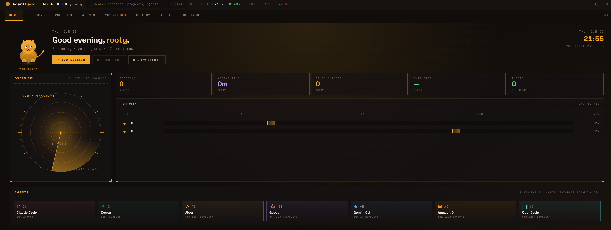
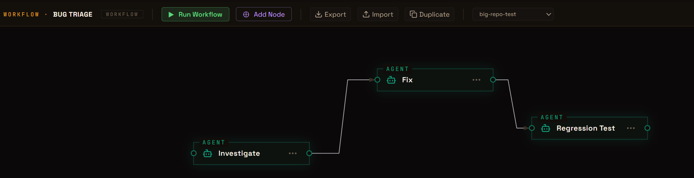

<div align="center">

# AgentDeck

**A desktop deck for your WSL coding agents.**

Launch, watch, and orchestrate Claude Code, Codex, Aider, four more built-in
agents — and your own custom CLIs — from a single window: split terminals,
visual workflows, and productivity + plan-limit tracking, all running through
your own WSL environment.

[](https://www.electronjs.org)
[](https://react.dev)
[](https://www.typescriptlang.org)
[](LICENSE)
[](#status)
[](https://github.com/Wintersta7e/agentdeck/actions/workflows/ci.yml)
[](https://codecov.io/gh/Wintersta7e/agentdeck)

<br>



</div>

> [!WARNING]
> **Archived (October 2026).** AgentDeck is no longer developed. The last release,
> v7.2.0, is provided as is, with no further fixes, including security fixes.
> Known issues in it:
>
> - Its bundled Electron 44.4.1 has known security advisories. Building from `main`
>   picks up a newer Electron pin, but needs a clean install (`npm ci --no-bin-links`)
>   and leaves the issues below in place.
> - On Linux without an OS keyring, project environment variables marked secret are
>   stored as plain text in the settings file, and custom-agent secrets are dropped
>   when the app loads.
> - On Linux, the file tree, the Env tab, stack detection and "open externally" fail,
>   because paths are converted to Windows form. Linux and macOS are not supported.
> - Launching any build with a fresh settings folder against an existing
>   `~/.agentdeck` replaces the templates folder, deleting templates saved there.
>
> Your data (projects, templates, workflows, history) stays where it is, as plain
> JSON; archiving touches no local file.

---

## Why

I work across half a dozen AI coding agents, and each one is its own CLI in its
own terminal tab. Switching between Claude Code, Codex, Aider, and the rest
meant juggling windows, re-typing project paths, and losing track of which
session was doing what.

So I built AgentDeck for myself: open a project, pick an agent, and you're in a
terminal. Split the screen to run two agents side by side. Chain them into
visual workflows with conditions, loops, and variables. Keep prompt templates,
project configs, and session history in one place instead of scattered across
shells.

It's a desktop app, not a web service — your code stays local, secrets are
encrypted by the OS keychain on Windows, agents run in your own WSL environment,
and there is no telemetry. It's a personal tool under Elastic-2.0: you're welcome to clone and
build it, but there's no adoption goal and no support guarantees.

## Status

Archived personal tool; the last release is **v7.2.0** (see the notice above).
It has a large Vitest suite under a zero-warning lint + typecheck gate, and it is
shaped around exactly one setup (Windows 11 + WSL2).

**Implemented:**
- 7 built-in agents: Claude Code, Codex, Aider, Goose, Gemini CLI, Amazon Q,
  OpenCode — plus **custom agents** (bring your own CLI, e.g. a local model
  runner or a personal wrapper), first-class in the picker, palette, project
  defaults, and workflows
- Split terminal sessions (up to 3 panes) with caching, search, and live
  activity parsing
- Visual workflow engine — agent / shell / checkpoint / condition nodes,
  branching, loops, `{{VAR}}` variables, and per-run history
- Per-session git worktree isolation with a Keep / Discard review flow
- Productivity tracking (sessions · active time · files changed) for every agent,
  plus real Codex plan-limit gauges (5h / weekly), persisted across restarts
- Home dashboard — daily digest, live session grid, 7-day activity, plan limits,
  project cards
- Prompt templates, command palette, three themes

**Rough edges / not done:**
- Built for Windows + WSL2 only. Linux and macOS are not supported; the native
  Linux path in 7.2.0 is incomplete (see the notice above)
- Real subscription plan-limit data is Codex-only (the only agent that exposes
  it on disk); every other agent shows a rolling-5h activity tile instead
- Ships as a portable `.exe` — no installer, no auto-update

**Explicitly declined (not on the roadmap):**
- Cloud sync • multi-user / team mode • telemetry or analytics • a hosted web
  version • plugin marketplace

## Features

### Terminal sessions
- Up to 3 panes side by side with draggable dividers; bare WSL shells (`Ctrl+T`)
- Sessions cached across tab switches — no re-render on return
- In-terminal search (`Ctrl+Shift+F`) with regex and case-sensitive modes
- Real-time activity parsing of agent tool use (reads, writes, commands)
- Per-session right panel: Files, Diff (Keep / Discard), Prompts, Env, Config
- New-session composer: pick an agent, drop in a prompt, set branch mode, launch

### Home dashboard
- Daily digest — session count, active time, files changed, exit rate, top agent
- Live session grid with activity pulse
- Productivity panel — sessions · active time · files changed, with a 7-day sparkline
- Plan-limits panel — real Codex 5h / weekly gauges; rolling-5h activity per agent
- Timeline + HISTORY persist across restarts (disk-backed per-session log)
- Project cards with git status; proactive suggestions; quick actions

### Workflows
- Drag-and-drop node graph: agent, shell, checkpoint, and condition nodes
- Edge-activation scheduler — ready queue, branching, skip propagation, loops
- Conditional routing on exit code or output match; per-node retry with delay
- `{{VAR}}` substitution via a typed pre-run dialog; 8 seed roles for personas
- Import / export as `.agentdeck-workflow.json`; per-run history with timings

<p align="center">
  
</p>

### Projects & templates
- 5-step new-project wizard, multiple agents per project, auto stack detection
- 16 seed prompt templates across 8 categories, with a live-preview editor
- Pin favourites to the home grid

### Agents
- A single registry drives CLI flags, colour, and capabilities for all 7 built-ins
- **Custom agents (bring-your-own)** — register your own CLI (Ollama, a local
  model runner, a personal wrapper) from the Agents screen or `agents.toml`:
  binary, one-argument-per-row launch args, env, and display metadata, first-class
  across the picker, palette, project defaults, and workflow nodes
- Startup update check + one-click npm update with rollback
- Auto-detection via the WSL `PATH`

### Theming

| Theme | Vibe |
|-------|------|
| **Tungsten** (default) | Sodium amber on warm charcoal |
| **Phosphor** | Retro CRT green on ink |
| **Dusk** | Violet + coral on plum-black |

All values come from CSS custom properties in `tokens.css`; per-agent accent
tokens keep each agent's colour consistent across every theme.

## Keyboard shortcuts

| Shortcut | Action | | Shortcut | Action |
|----------|--------|---|----------|--------|
| `Ctrl+K` | Command palette | | `Ctrl+1/2/3` | Pane layout |
| `Ctrl+N` | New project | | `Ctrl++/-` | Zoom in / out |
| `Ctrl+T` | New terminal | | `Ctrl+0` | Reset zoom |
| `Ctrl+\` | Toggle right panel | | `Ctrl+Shift+F` | Search in terminal |
| `Ctrl+/` | Shortcut reference | | `Alt+1..8` | Jump to tab |

## Quick start

Grab the portable `.exe` from the [latest release][releases] — no installer, no
runtime to set up. To build or develop instead, you need Windows 10/11 with WSL2
(Ubuntu recommended), Node.js 22.22.1+ (see `.nvmrc`), and at least one agent CLI
installed inside WSL.

```bash
# Install (--no-bin-links is required on Windows-mounted drives)
npm install --no-bin-links

# Dev with hot reload
npm run dev

# Checks
npm run lint        # ESLint over the whole repo, zero warnings
npm run typecheck   # tsc on the node + web + tools configs
npm test            # Vitest

# Build a portable .exe (gated: lint + typecheck + tests, then build + verify)
npm run release-portable
```

Output: `dist/AgentDeck-{version}-portable.exe` (~101 MB). Building on Linux
produces `dist/AgentDeck-{version}-x86_64.AppImage` instead.

## Stack

| Layer | Choice | Notes |
|---|---|---|
| Shell | [Electron 44][electron] | ConPTY; node-pty in the **main process only** |
| UI | [React 19][react] + [TypeScript 6][ts] | Strict mode, all `.ts` / `.tsx` |
| Build | [electron-vite 5][evite] | Vite for the renderer, esbuild for main/preload |
| Terminal | [xterm.js 5][xterm] + [node-pty][nodepty] | WebGL renderer over WSL PTYs |
| State | [Zustand][zustand] | One flat store composed from 8 slices |
| Workflows | [React Flow][reactflow] | Visual DAG editor |
| Storage | [electron-store][estore] | JSON on disk; `safeStorage` for secrets |
| Test / lint | [Vitest 5][vitest] + [ESLint 9][eslint] | Dual workspace, type-aware, zero-warning |

## Layout

```
src/
├── main/       # Electron main: PTY, IPC, workflow engine, WSL + git, persistence
├── preload/    # contextBridge → window.agentDeck (the preload API)
├── renderer/   # React app: terminals, workflow editor, dashboard, command palette
└── shared/     # Agent registry, domain types, workflow + id validation (no Node/DOM)
```

`WorkflowNode` is a discriminated union — `AgentNode | ShellNode | CheckpointNode
| ConditionNode` — so engine dispatch and validation stay exhaustive at compile
time. Every IPC handler that takes a caller-supplied id validates through
`shared/validation`. New themes, agents, and node types are added by extending a
single registry; the type system flags any consumer that missed the update.

## Design principles

1. **Local-first.** No web service, no account, no telemetry. Code stays on your
   machine, secrets are encrypted by the OS keychain on Windows, and fonts are
   bundled, not fetched.
2. **One process model, done right.** node-pty lives in the main process only;
   the renderer runs with `contextIsolation` on and `nodeIntegration` off.
3. **Single source of truth.** Agents, themes, and node types each come from one
   registry; the type system surfaces anything a new entry forgot to update.
4. **No magic numbers.** Every colour, space, font size, and duration is a
   design token in `tokens.css` — a theme is just a set of tokens.
5. **WSL-native on Windows.** Paths, git, and agent CLIs run inside your WSL
   distro.

## Documentation

- [User Guide](./docs/USER-GUIDE.md) — detailed usage
- [Changelog](./CHANGELOG.md) — version history
- [Contributing](./CONTRIBUTING.md) — how to contribute
- [Security](./SECURITY.md) — reporting vulnerabilities

## License

[Elastic License 2.0](./LICENSE) — free to use, modify, and share. You may not
offer it as a hosted or managed service.

---

<sub>AgentDeck is an archived personal tool — it was built for my own use across
Windows + WSL2, with no telemetry, analytics, or growth metrics. Not chasing adoption, but
if it looks useful you're welcome to try it.</sub>

[electron]:   https://www.electronjs.org
[react]:      https://react.dev
[ts]:         https://www.typescriptlang.org
[evite]:      https://electron-vite.org
[xterm]:      https://xtermjs.org
[nodepty]:    https://github.com/microsoft/node-pty
[zustand]:    https://zustand-demo.pmnd.rs
[reactflow]:  https://reactflow.dev
[estore]:     https://github.com/sindresorhus/electron-store
[releases]:   https://github.com/Wintersta7e/agentdeck/releases/latest
[vitest]:     https://vitest.dev
[eslint]:     https://eslint.org
